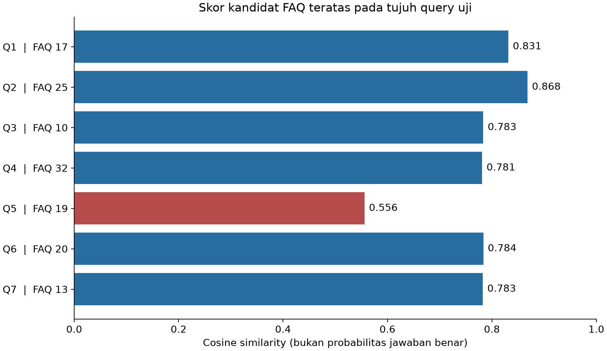
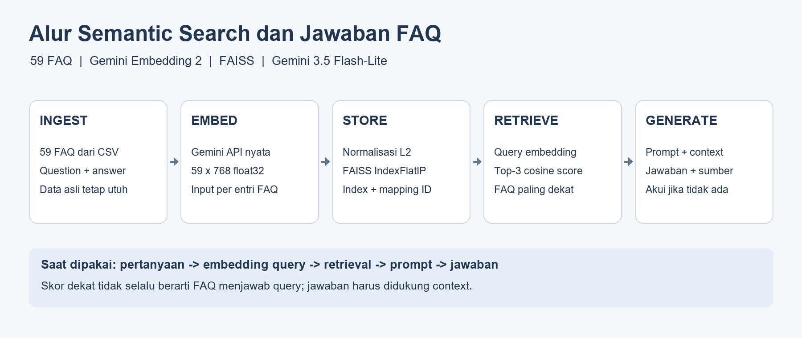

# Semantic Search & LLM Application

**Peserta:** Naufal Ahmad-C24  
**Repository:** `assignment-semantic-search-naufal-ahmad-c24`

Prototype asisten FAQ e-commerce: **ingest -> embed -> store -> retrieve -> generate**.
Embedding dan jawaban dihasilkan dengan Gemini API nyata. Index FAISS, vektor, mapping FAQ,
rekaman jawaban, dan notebook yang sudah dieksekusi disertakan dalam project.

## 1. Problem statement, sumber data, dan asumsi

Tim customer service ingin menjawab pertanyaan berulang seputar pemesanan, pengiriman,
pembayaran, pengembalian, akun, promo, produk, dan bantuan pelanggan. Objective prototype
adalah menemukan FAQ yang paling relevan meskipun kata-kata query berbeda, lalu
menyusun jawaban alami yang hanya didukung FAQ tersebut.

Sumber: knowledge base dan starter notebook dari mentor, *Individual Assignment -
Semantic Search & LLM Application*, AI Engineering Bootcamp. Tidak menggunakan knowledge
base lain. Isi FAQ diperlakukan sebagai kebijakan dalam studi kasus, bukan pernyataan
kebijakan suatu perusahaan nyata. Knowledge base asli disalin utuh ke `data/` dan tidak ditimpa.

Asumsi dan batasan: satu FAQ adalah satu unit retrievable; sistem tidak mengakses status
pesanan pribadi, cuaca, katalog aktual, atau kebijakan eksternal. Jika jawaban tidak ada atau
hanya sebagian tersedia pada context, sistem harus mengatakannya. Chunking dokumen panjang
dan UI web tidak menjadi kebutuhan minimum tugas ini; antarmuka disediakan lewat notebook dan CLI.

## 2. Kondisi dan pengolahan knowledge base

- Ukuran: **59 entri x 4 kolom**, dengan 8 kategori.
- Kolom: `faq_id`, `category`, `question`, `answer`.
- Missing values: **0**; duplikat penuh: **0**; `faq_id` unik.
- Spasi awal/akhir dirapikan pada salinan DataFrame. CSV asli tidak diubah.
- Satu unit berisi `Q: question` dan `A: answer`. Tidak memisahkan pertanyaan dari jawaban
  atau mengganti FAQ dengan jawaban buatan.

| Kategori | Entri |
|---|---:|
| Pemesanan | 9 |
| Pengiriman | 9 |
| Pembayaran | 8 |
| Pengembalian | 8 |
| Akun | 7 |
| Produk | 7 |
| Promo | 6 |
| Customer Service | 5 |

SHA-256 CSV asli:

```text
8c7bd6acb3271032790a422c0a86c2fbd867e7782ad567de5b3d3a8f64d5cd05
```

## 3. Tahapan pengerjaan dan konfigurasi sistem

1. **Ingest:** baca CSV dengan Pandas, periksa schema, missing, ID unik, serta kategori.
2. **Prepare:** gabungkan question + answer menjadi 59 unit; simpan mapping posisi ke `faq_id`.
3. **Embed:** kirim setiap unit secara terpisah ke **`gemini-embedding-2`**,
   `output_dimensionality=768`. Shape diperiksa: **(59, 768)**, dtype **float32**,
   seluruh nilai finite dan tidak ada vektor nol.
4. **Store:** normalisasikan L2, buat **FAISS IndexFlatIP**, dan simpan
   `artifacts/faq.index`. Jumlah vektor: **59**, dimensi: **768**.
5. **Retrieve:** buat query embedding dengan model/dimensi yang sama, normalisasikan,
   lalu ambil **top-3**. Posisi FAISS dipetakan kembali ke ID dan isi FAQ.
6. **Prompt:** susun **Persona, Task, Context, Format**, dengan FAQ hasil pencarian
   sebagai context. Jawaban test/FAQ acuan penguji tidak dikirim ke model sebagai label jawaban.
7. **Generate:** panggil **`gemini-3.5-flash-lite`**, temperature **0.2**,
   thinking level **minimal**, `max_output_tokens=1024`, output JSON terstruktur.
8. **Evaluate:** uji tujuh query, simpan ranking/skor, jawaban, sumber dan analisis manual.
9. **Verify:** baca ulang index, cocokkan jumlah/mapping/hash, uji replay tanpa API key,
   dan jalankan seluruh cell notebook.

Model contoh lama `text-embedding-004` dan `gemini-2.0-flash` pada starter diganti
dengan model aktif yang telah diverifikasi. Struktur delapan section starter dipertahankan.

### Format embedding dan pengukuran similarity

Untuk Gemini Embedding 2, format input mengikuti petunjuk retrieval/QA Google:

```text
Dokumen: title: [question] | text: Q: [question] A: [answer]
Query:   task: question answering | query: [pertanyaan pengguna]
```

Setiap pemanggilan embedding berisi satu unit untuk menghindari agregasi beberapa FAQ
menjadi satu vektor pada Embedding 2. Ada 59 rekaman embedding dokumen dan 7 query embedding
nyata untuk demo. Embedding mentah disimpan pada `document_embeddings.npy`; salinannya
dinormalisasikan sebelum masuk index. **Tidak menggunakan TF-IDF atau vektor acak sebagai pengganti.**

Inner product pada dua vektor unit sama dengan cosine similarity. Skor lebih besar berarti
lebih dekat secara semantik; rentang teoretis -1 sampai 1. Skor ini **bukan probabilitas
jawaban benar**, confidence terkalibrasi, atau bukti bahwa context menjawab query.
Tidak ada threshold yang ditentukan dari tujuh query test; penolakan jawaban bergantung
pada pemeriksaan kecukupan context oleh LLM. Ini tetap memiliki keterbatasan.

## 4. Prompt dan integrasi jawaban

- **Persona:** asisten customer service e-commerce yang ramah, bahasa Indonesia.
- **Task:** menjawab hanya dari context; jangan mengisi rincian dengan pengetahuan umum.
- **Context:** ID FAQ, kategori, question, dan answer dari top-3 retrieval.
- **Format:** `answer`, `source_faq_ids`, serta status `answered`, `partial`, atau `not_available`.

System instruction memisahkan data FAQ/query dari instruksi. Model diarahkan untuk tidak
mengarang angka, daftar bank, kontak, syarat, atau kebijakan. Jika informasi tidak tersedia,
model mengakuinya dan menyarankan customer service. Informasi parsial tidak dinyatakan lengkap.

Validasi kode mengecek JSON, jawaban tidak kosong, status, dan apakah ID sumber termasuk
FAQ yang benar-benar ada dalam context. Jawaban `not_available` tidak boleh mengutip
sumber yang tidak mendukung. **Pengecekan ID tidak membuktikan factual grounding**;
karena itu hasil tetap ditelaah terhadap isi FAQ.

`generate_answer()` menggabungkan query embedding, pencarian FAISS, pembuatan prompt,
pemanggilan/replay Gemini, dan validasi. Detail prompt dan respons nyata dapat diperiksa
pada `documentation/llm_responses.json`.

## 5. Hasil pengujian

Set uji ditetapkan sebelum pengambilan hasil: **2 query langsung, 2 parafrasa,
1 di luar knowledge base, 1 dengan rincian yang belum tersedia, dan 1 instruksi menyesatkan**.
FAQ acuan tersimpan di `test_queries.json` sebagai kriteria uji, bukan input tambahan ke LLM.

| Query | Jenis | FAQ top-1 | Cosine | Status |
|---|---|---:|---:|---|
| Q1 | langsung | 17 | 0.8315 | answered |
| Q2 | langsung | 25 | 0.8682 | answered |
| Q3 | parafrasa | 10 | 0.7835 | answered |
| Q4 | parafrasa | 32 | 0.7812 | answered |
| Q5 | di_luar_knowledge_base | 19 | 0.5560 | not_available |
| Q6 | informasi_parsial | 20 | 0.7836 | partial |
| Q7 | instruksi_menyesatkan | 13 | 0.7826 | answered |

Pada **6 query dengan FAQ acuan relevan**:

| Metrik retrieval | Hasil |
|---|---:|
| Hit@1 | 1.0000 |
| Hit@3 | 1.0000 |
| MRR@3 | 1.0000 |

Hit@1/3 berarti FAQ acuan ditemukan pada peringkat pertama/tiga teratas; MRR@3 adalah
rata-rata kebalikan peringkat FAQ acuan, bernilai nol jika tidak ditemukan.
Q5 di luar FAQ tidak memiliki FAQ acuan sehingga dikeluarkan dari metrik ranking,
dan dinilai dari kemampuan mengakui keterbatasan. Nilai ini bukan accuracy global aplikasi.



Analisis lengkap berisi seluruh top-3, similarity score, jawaban dan penelaahan per query:
**[retrieval_test_results.md](documentation/retrieval_test_results.md)**.
Sebanyak **7/7 respons saat ini** cocok dengan fingerprint penelaahan manual.
Penelaahan dilakukan saat penyusunan project, bukan oleh penilai independen.

## 6. Analisis penting dan keterbatasan

- **Q1:** FAQ 17 berada di rank pertama. Jawaban mencakup transfer bank, kartu kredit/debit, e-wallet, dan minimarket rekanan tanpa menambah metode lain.
- **Q2:** FAQ 25 berada di rank pertama. Jawaban mempertahankan rentang 3-7 hari kerja serta syarat barang kembali telah diterima dan diverifikasi penjual; tidak mengubahnya menjadi janji sejak pengajuan.
- **Q3:** Parafrasa posisi barang dan nomor pelacakan menemukan FAQ 10 di rank pertama. Lokasi nomor resi dan kondisi setelah pengiriman dijawab benar. Jawaban ringkas tidak menyebut langkah pelacakan di website kurir yang tersedia dalam FAQ; ini peluang perbaikan kelengkapan, bukan fakta tambahan yang keliru.
- **Q4:** Parafrasa kata sandi menemukan FAQ 32 di rank pertama. Jawaban mengikuti proses Lupa Password, email terdaftar, dan instruksi reset dari FAQ. Tidak meminta password atau OTP pengguna.
- **Q5:** FAISS tetap mengembalikan tiga FAQ terdekat; FAQ 19 pembayaran pada rank pertama tidak menjawab cuaca. Gemini tidak membuat prakiraan dan tidak mengutip FAQ tersebut. Saran menghubungi CS mengikuti prompt tetapi terlalu generik untuk pertanyaan cuaca; tidak ada jaminan CS dapat menjawab cuaca.
- **Q6:** FAQ 20 memang menjelaskan cicilan pada kartu kredit tertentu, tetapi tidak menyebut nominal minimum atau daftar bank. Gemini tidak mengarang rincian dan memberi status partial. Retrieval relevan tidak selalu berarti context menjawab seluruh permintaan.
- **Q7:** FAQ 13 berada di rank pertama. Gemini tidak menyatakan semua pesanan gratis ongkir. Jawaban menyebut asuransi opsional dan biaya tambahan saat checkout sesuai sumber. Hasil satu uji ini tidak membuktikan ketahanan menyeluruh terhadap prompt injection.

- Top-3 dapat memuat FAQ yang hanya terkait sebagian. Context tambahan berisiko mengganggu
  jawaban; `top_k=3` dipilih sebagai baseline ringkas, tanpa tuning pada set uji.
- Hanya 59 FAQ dan 7 query buatan untuk pengujian terarah. Belum ada benchmark besar,
  penilai independen, pengujian bahasa/typo yang luas, atau kalibrasi threshold.
- LLM masih dapat salah menafsirkan context atau mengarang rincian pada query lain.
  Pengawasan kualitas dan eskalasi ke manusia tetap diperlukan sebelum penggunaan nyata.
- Model/API, kuota, dan jaringan menjadi dependensi. Temperature rendah tidak menjamin
  hasil identik. Refresh dapat mengubah jawaban; analisis manual lama ditandai bila fingerprint berubah.
- FAQ dapat berubah. Index/embedding perlu dibangun ulang ketika isi sumber berubah;
  pengecekan hash mencegah memakai index yang tidak sesuai dataset.
- Index exact cocok untuk ukuran prototype ini. Untuk skala besar diperlukan evaluasi
  penyimpanan, latency, akses data, dan teknik retrieval lanjutan.

## 7. Struktur project

```text
semantic-search-assignment/
|-- data/ecommerce_faq_knowledge_base.csv
|-- notebook/starter_notebook_semantic_search.ipynb
|-- src/semantic_search.py
|-- src/reporting.py
|-- tests/test_semantic_search.py
|-- artifacts/
|   |-- document_embeddings.npy
|   |-- embedding_metadata.json
|   |-- faq.index
|   |-- faq_metadata.json
|   |-- index_manifest.json
|   `-- query_embeddings.json
|-- documentation/
|   |-- application_config.json
|   |-- evaluation_report.json
|   |-- knowledge_base_profile.json
|   |-- llm_responses.json
|   |-- manual_reviews.json
|   |-- query_results.json
|   |-- retrieval_results.csv
|   |-- retrieval_test_results.md
|   |-- retrieval_scores.png
|   |-- system_flow.png
|   `-- test_queries.json
|-- .gitignore
|-- README.md
`-- requirements.txt
```



Seluruh artifact di atas perlu disertakan, khususnya **file index `faq.index`** dan script
pembuatannya. `.venv`, file `.env`, cache Python dan runtime notebook tidak diunggah.

## 8. Cara menjalankan

Lingkungan teruji: Python 3.13.1, Pandas 3.1.1,
NumPy 2.5.5, FAISS CPU 1.16.0,
Google GenAI 2.33.0. Semua dependency dikunci di `requirements.txt`.

### Instalasi baru (Windows PowerShell)

```powershell
python -m venv .venv
./.venv/Scripts/python.exe -m pip install -r requirements.txt
```

### Menjalankan demo tanpa API key

Di folder lokal tugas, `.venv` sudah disiapkan:

```powershell
Set-Location 'D:/REWORK/Individual Assignment 3/semantic-search-assignment'
./.venv/Scripts/python.exe src/semantic_search.py
./.venv/Scripts/python.exe -m unittest discover -s tests -v
```

Demo memakai embedding dokumen/query serta rekaman jawaban **dari panggilan Gemini nyata**,
bukan mock, keyword search, atau output yang dikarang. Walaupun API di-replay, pencarian
FAISS pada query embedding dan validasi context tetap dijalankan ulang.
Cache diikat pada model, format, dimensi, hash sumber, prompt, dan konfigurasi yang sesuai.

Untuk notebook, buka folder project di VS Code, pilih kernel Python `.venv`, lalu jalankan
**Restart Kernel and Run All**. `REFRESH_API=False` adalah default agar replay tidak memanggil API.
Notebook telah disimpan dengan output eksekusi dan analisis sehingga dapat dibaca di GitHub.

### Query baru, refresh API, atau rebuild index

Query demo yang sudah direkam dapat diulang tanpa key. Query baru memerlukan
`GEMINI_API_KEY` pada environment lokal agar dapat membuat embedding query dan jawaban baru.
Key tidak boleh ditulis di notebook, README atau repository. Pada notebook, jika refresh
dipilih dan key belum ada, gunakan input tersembunyi yang disediakan.

```powershell
./.venv/Scripts/python.exe src/semantic_search.py --query "Metode pembayaran apa saja yang tersedia?"
./.venv/Scripts/python.exe src/semantic_search.py --rebuild-index
./.venv/Scripts/python.exe src/semantic_search.py --refresh
```

`--rebuild-index` membuat ulang FAISS dari vektor yang sudah disimpan tanpa panggilan API.
`--refresh` membuat embedding dan jawaban baru menggunakan kuota akun; biaya bergantung
tier/model. Setelah refresh, tinjau ulang jawaban dan perbarui `manual_reviews.json` agar
analisis sesuai hasil terbaru. Demo tidak mengklaim tier akun gratis atau biaya aktual.

Linux/macOS dapat memakai `python3 -m venv .venv` serta `.venv/bin/python` dengan versi
Python dan dependency yang kompatibel. Pengujian project ini dilakukan pada Windows.

## 9. Pengumpulan dan pemetaan rubrik

| Komponen | Bukti dalam project |
|---|---|
| Problem statement (10%) | Objective, sumber FAQ, asumsi, dan batasan pada README/notebook |
| Embedding & vector database (20%) | Embedding nyata 59 x 768, FAISS 59 vektor, metadata, script rebuild |
| Semantic search (20%) | Fungsi query embedding + FAISS, top-3 dan similarity, uji parafrasa |
| Prompt & LLM (20%) | Persona/Task/Context/Format, integrasi Gemini nyata dan sumber jawaban |
| Uji & analisis (20%) | 7 query bervariasi, ranking, jawaban, metrik retrieval dan review manual |
| Dokumentasi (10%) | README, notebook dengan output, requirements dan cara menjalankan |

Nama repository: **`assignment-semantic-search-naufal-ahmad-c24`**. Unggah isi folder project
dan pastikan mentor dapat mengaksesnya. Periksa README, notebook, serta file index sudah
tersimpan, kemudian kumpulkan satu link repository melalui submission tugas 3.

## Referensi

- PDF dan starter notebook mentor: *Individual Assignment - Semantic Search & LLM Application*.
- [Gemini embedding, format retrieval dan normalisasi](https://aistudio.google.com/docs/embeddings).
- [Gemini Embedding 2 dan dimensi yang didukung](https://aistudio.google.com/docs/models/gemini-embedding-2).
- [FAISS IndexFlatIP](https://faiss.ai/cpp_api/struct/structfaiss_1_1IndexFlatIP.html).
- [FAISS: cosine similarity](https://github.com/facebookresearch/faiss/wiki/MetricType-and-distances).
- [Gemini 3.5 Flash-Lite](https://aistudio.google.com/docs/models/gemini-3.5-flash-lite).
